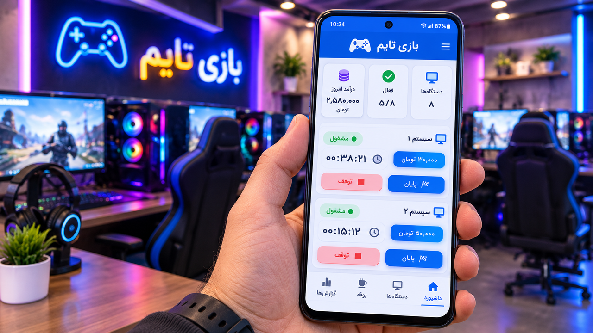

# بازی تایم | Bazi Time

**بازی تایم** اپلیکیشن مدیریت گیم‌نت و بوفه است. با این برنامه مدیر مجموعه می‌تواند دستگاه‌ها، زمان بازی، هزینه جلسات و فروش بوفه را از طریق موبایل مدیریت کند.

## امکانات

- مدیریت دستگاه‌های گیم‌نت و مشاهده وضعیت آزاد یا در حال بازی
- شروع، مکث، ادامه و پایان زمان بازی هر دستگاه
- نمایش تایمر و محاسبه هزینه بازی بر اساس تعرفه
- ثبت یادآوری برای زمان بازی
- ثبت فروش محصولات بوفه
- محاسبه جداگانه هزینه بازی و بوفه و نمایش جمع حساب هر دستگاه
- مشاهده تعداد دستگاه‌ها، دستگاه‌های فعال و درآمد روزانه
- گزارش فروش، هزینه بازی و تراکنش‌ها
- مدیریت حساب مشتریان و مشاهده بدهی‌ها
- تنظیمات برنامه و تهیه یا بازیابی فایل پشتیبان

## مناسب برای

گیم‌نت‌ها، مراکز بازی و مجموعه‌هایی که چند دستگاه بازی و بوفه دارند و می‌خواهند زمان استفاده، هزینه‌ها و فروش را یکجا مدیریت کنند.

## دانلود نسخه اندروید

فایل APK پس از ساخت، از بخش **Actions → Artifacts** دریافت می‌شود. نسخه‌های قابل انتشار نیز در بخش **Releases** قرار می‌گیرند.
